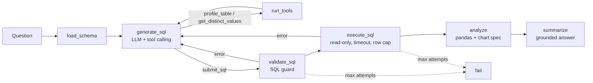

# AI Analytics Copilot: Agentic Text-to-SQL

Ask a business question in plain English and get the SQL, a chart, a data table, a short written answer and a PDF report. A **LangGraph agent** inspects the data with tools, writes SQL, checks it through a **read-only SQL guard**, repairs its own mistakes, and reports latency, tokens and cost for every request.

**Live demo:** _add your Hugging Face Space URL here_

## How it works



- **Tool calling:** before answering, the model can call `profile_table` (row count, distinct counts, min/max, sample values) or `get_distinct_values` to match filters exactly. It must finish with `submit_sql`, a structured call that carries the SQL plus a chart choice (`bar`, `line`, `pie`, `scatter`, `table`) and the x/y columns.
- **Self-repair:** validation or database errors go back to the model as tool results, so it can fix the query. Attempts are capped (`MAX_SQL_ATTEMPTS`, default 3).
- **Provider-agnostic LLM:** one OpenAI-compatible client covers Groq (default, free tier), OpenAI, Gemini's OpenAI endpoint and local Ollama.

## SQL safety: defense in depth

| Layer | What it blocks |
| --- | --- |
| SQL guard (`app/sql/guard.py`) | Multiple statements, anything but `SELECT`/`WITH`, write/DDL keywords even inside CTEs (`DELETE … RETURNING`, `SELECT … INTO`, `FOR UPDATE`), dangerous functions (`pg_sleep`, `pg_read_file`, `dblink`, …), system catalogs, unknown or non-allowlisted tables. Comments and string literals are masked first so they can't hide or fake keywords. |
| Row cap | Every query is wrapped as `SELECT * FROM (…) LIMIT n+1`, so results are capped and flagged as truncated. |
| Read-only connection | SQLite opens with `mode=ro`; PostgreSQL runs in `SET TRANSACTION READ ONLY`. |
| Timeout | SQLite progress-handler deadline; PostgreSQL `statement_timeout`. |
| Tool allowlist | The model can run only the three registered tools, and they go through the same guard. |
| Rate limit | Per-IP sliding window on `/api/ai/ask` protects the public demo's LLM quota. |

## Evaluation

`evals/questions.jsonl` holds **40 business questions** (15 easy, 15 medium, 10 hard) with gold SQL on the demo database. The runner measures **execution accuracy**: the agent's result must match the gold result, ignoring column names, extra columns and row order unless the question asks for a ranking. It also reports first-try vs after-repair success, p50/p95 latency, tokens and cost.

```bash
export GROQ_API_KEY=...            # free key from console.groq.com
python scripts/seed_demo_db.py
python -m evals.run_eval           # writes evals/results/report.md and results.json
```

In GitHub Actions, run the **CI** workflow manually (`Run workflow`) to execute the eval and publish the report to the job summary. Add `GROQ_API_KEY` under *Settings → Secrets and variables → Actions* first.

| Model | Execution accuracy | Easy | Medium | Hard | p50 latency |
| --- | --- | --- | --- | --- | --- |
| _run the eval and paste your numbers here_ | | | | | |

## Run locally

```bash
cp .env.example .env               # add GROQ_API_KEY
docker compose up --build          # http://localhost:7860
```

Without Docker:

```bash
pip install -r requirements.txt
python scripts/seed_demo_db.py
uvicorn app.main:app --port 8002 &
BACKEND_URL=http://localhost:8002 streamlit run frontend/streamlit_app.py
```

The API docs are at `http://localhost:8002/docs`. Set `DATABASE_URL=postgresql://…` to point the agent at your own PostgreSQL database.

## Deploy to Hugging Face Spaces (free)

1. Create a Space at huggingface.co/new-space and choose **Docker** → **Blank**.
2. In the Space, open **Settings → Variables and secrets** and add the secret `GROQ_API_KEY`.
3. Push this repository to the Space:
   ```bash
   git remote add space https://huggingface.co/spaces/<your-username>/ai-analytics-copilot
   git push space main
   ```
4. The Space builds the Dockerfile, seeds the demo database and serves the app on port 7860.

## API

| Method | Path | Purpose |
| --- | --- | --- |
| `POST` | `/api/ai/ask` | `{"question": "..."}` → answer, SQL, rows, chart, trace, usage |
| `POST` | `/api/data/upload` | Upload a CSV; it becomes a queryable table |
| `GET` | `/api/health` | Model, database and table list |
| `POST` | `/api/auth/login` | JWT for `ADMIN_USERNAME` / `ADMIN_PASSWORD` from the environment |

## Project layout

```
app/agent/      LangGraph nodes, routing, tools and prompts
app/sql/        SQL guard and read-only executor (SQLite + PostgreSQL)
app/llm/        OpenAI-compatible client with tool calling and cost tracking
app/api/        FastAPI endpoints
evals/          40-question gold set and execution-accuracy runner
frontend/       Streamlit UI
scripts/        Deterministic demo-database seeder
tests/          Guard, executor, agent (scripted fake LLM), eval and upload tests
```

## Tests

```bash
pip install pytest && python -m pytest tests -q
```

The agent tests use a scripted fake LLM, so they need no API key or network.
